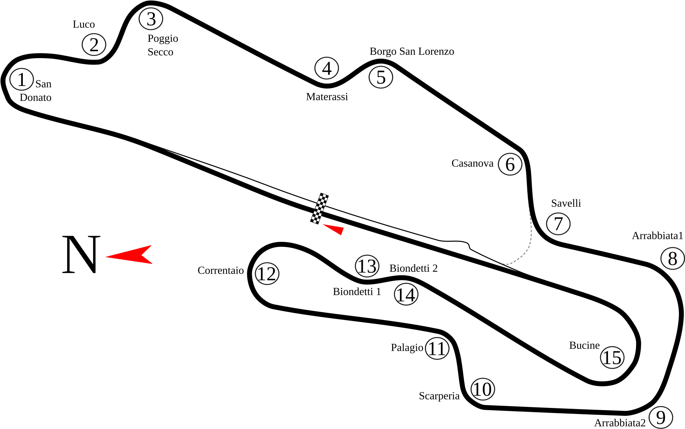

# Mugello GP — Mercedes-AMG GT3 2020 (iRacing). Гайд для Артёма

**Серия:** GT3 Regional Tour Europe (Fixed) · **Машина:** Mercedes-AMG GT3 2020 · **Трасса:** Autodromo Internazionale del Mugello, Grand Prix

---

## 1. Коротко о трассе и о цели

Mugello — быстрая трасса в холмах с перепадом высот около 50 м: связки поворотов один за другим, слепые входы на гребнях и длинная прямая, примерно 1 км.
**Длина:** 5.191 км — цифра из брифа, в iRacing не сверял. Официальная длина реальной трассы — **5.245 км**, 15 поворотов (источник: discovermugello.it).

**От чего зависит время круга:**
- **Ритм быстрых перекладок.** Luco–Poggio Secco, Materassi–Borgo, Casanova–Savelli, Biondetti. Здесь время теряют не на торможении, а на рывках рулём и пропущенной перекладке.
- **Выходы в подъём и на прямые.** Bucine выводит на прямую около 1 км — это самый дорогой выход круга. Savelli выводит к Arrabbiata, Correntaio — к Biondetti.
- **Смелость в быстрых поворотах.** Arrabbiata 1–2 и Borgo San Lorenzo — это скорость в повороте, а не точка торможения.

**Твой текущий темп (2 сессии, baseline):**
- Лучший круг **1:49.250**. Рабочее ядро — **1:50.10** при разбросе около 0.28 с.
- Оптимум по лучшим секторам — **1:49.133**. От лучшего круга до оптимума всего 0.117 с, а от ядра — почти 1 секунда.

**Цель:** перевести ядро из 1:50.1 в **1:49.x сериями**, а не одним кругом. В квалификации стабильно выходить на 1:49.2 и быстрее.

> Ориентир по уровню (Track Titan, iRacing Mugello GP, BMW M4 GT3 — не Mercedes): верхние 5% едут примерно 1:47.2. Эталона именно для Mercedes-AMG GT3 2020 на iRacing Mugello открыть не удалось. Это ориентир масштаба, а не цель на ближайшие сессии.

---

## 2. Карта трассы

*Карта Mugello Circuit с официальной нумерацией 15 поворотов. Источник: Wikimedia Commons, «Mugello Racing Circuit track map 15 turns.svg», автор Will Pittenger, лицензия CC BY-SA 3.0. Исходник SVG лежит рядом: `img/mugello-map-15-turns.svg`.*

**Что смотреть на карте:**
- **Направление движения — по часовой стрелке.** От финиша вниз по прямой в правый шпильковый San Donato (1).
- **Связки, которые видны как одна линия:** 2–3 (Luco–Poggio Secco), 4–5 (Materassi–Borgo San Lorenzo), 6–7 (Casanova–Savelli), 8–9 (длинная дуга Arrabbiata), 13–14 (перекладка Biondetti).
- **Порядок 10 → 11 → 12.** Scarperia (10) и Palagio (11) идут сразу друг за другом. После короткого участка — шпилька Correntaio (12).
- **Bucine (15)** — длинный правый поворот, после него прямая через финиш. Пунктир у Savelli — это выезд с пит-лейна, а не траектория.

> **Чего на карте нет:** это не схема гоночной траектории и не скриншот iRacing. Готовую публичную картинку racing line именно для Mugello в iRacing, которую можно законно скачать, я не нашёл. Фальшивую схему рисовать не стал. Линию смотри в самом iRacing (раздел 2.1) и сверяй с ориентирами из блоков по поворотам.

### Поправка к списку поворотов

По официальной нумерации трассы (discovermugello.it, about-mugello-travel-guide.com, speedsport-magazine):
- **T11 называется Palagio, а не «Palatina».** В гайде везде Palagio.
- **T6/T7** на сайте трассы записаны как «Casanova-Savelli 1/2». В обиходе их зовут Casanova (T6) и Savelli (T7) — оставляю так.
- **Biondetti 1–2 = T13–T14.** На части карт это один поворот, и тогда Bucine идёт под номером 14. В iRacing и у нас Bucine — T15.

### 2.1 Как увидеть траекторию в самом iRacing (Driving Line)

- **Где включается:** в симе — **Options/Settings → Driving → Driving Aids → Driving Line** (по справке iRacing: «Driving aids can be enabled in the in-Sim Settings → Driving menu under Driving Aids»). Линия цветная: красная — зона торможения, зелёная — разгон.
- **Где она будет работать.** Это зависит от правил сессии, их видно в «Hardcore Level» и на странице Series Information. По справке iRacing:
  - сессии классов Rookie, D и C — помощники разрешены;
  - классы B, A и Pro — запрещено всё, кроме clutch assist;
  - в hosted-сессиях решает организатор;
  - в special events помощников нет.
- **Для GT3 Regional Tour Europe** открой Series Information и проверь, разрешены ли aids. Если они запрещены, линии не будет ни в практике серии, ни в квалификации, ни в гонке. Тогда она есть только в **Test Drive** и в своей hosted-сессии с «Allow all driving aids».
- **Как работать с линией.** В Test Drive сделай 3–5 кругов с Driving Line. По каждому ключевому повороту запиши, где начинается красная зона относительно реальных объектов (щит, начало бордюра, пост маршала, шов асфальта). Потом выключи линию и проедь по этим объектам.
- **Ограничения линии.** Она общая и не настроена под Mercedes, твой баланс и износ шин. Это подсказка, где искать, а не эталон. В официальной гонке полосы на асфальте не будет — нужны настоящие ориентиры.

---

## 3. Круг по секторам

| Сектор | Где (% дистанции) | Что внутри (примерно) | Твой лучший | Где брать время |
|---|---|---|---|---|
| **S1** | 0 → 35.66% | San Donato, Luco, Poggio Secco, вход в зону Materassi | **39.567** | Luco/Poggio — стабильно 3-я; не терять выход с T1 |
| **S2** | 35.66 → 64.42% | Materassi, Borgo S.L., Casanova–Savelli, Arrabbiata 1–2 (+, вероятно, подход к Scarperia) | **31.183** | Позднее и короткое торможение на Materassi (мин. скорость 151–156) |
| **S3** | 64.42 → 100% | Scarperia/Palagio, Correntaio, Biondetti 1–2, Bucine, прямая | **38.383** | Correntaio/Biondetti — 3-я, ранний газ, без наката |
| **Круг** | | | Лучший **1:49.250** · оптимум **1:49.133** · ядро **1:50.10** | |

*Привязка поворотов к процентам дистанции примерная. Точные границы — твои маркеры секторов из телеметрии (35.66% и 64.42%). Где именно Scarperia, в S2 или в начале S3, — сверь по следующему .ibt.*

---

## 4. Поворот за поворотом

Обозначения:
- **[ТВОЁ]** — факт из твоей телеметрии.
- **[ОРИЕНТИР]** — общий ориентир для GT3. Проверить на практике или включить Driving Line в Test Drive.
- **Направление поворотов** — по официальной карте трассы.

### T1 San Donato — правая, медленная, тяжёлое торможение после прямой
- **Передача:** 2-я в апексе [ОРИЕНТИР — типично для GT3 в iRacing].
- **Скорость апекса:** **100–105 км/ч — это твой стабильный минимум [ТВОЁ].** 92.6 было один раз, на лучшем круге. Это не цель: глубже тормозить не нужно, время здесь не теряешь.
- **Торможение:** самая тяжёлая точка круга, с максимальной скорости после прямой примерно в 1 км. Начинай у щитов дистанции перед поворотом [ОРИЕНТИР — какой щит твой, определи на практике].
- **Руль и газ:**
  - Прямо и жёстко на тормоз, затем отпускай его по мере поворота руля (trail braking).
  - Апекс поздний: выход длинный, а сразу за ним в подъём идёт Luco.
  - Газ — когда видишь выход к внешнему бордюру.
- **Твой приём [ТВОЁ]:** выход из San Donato — 3→2 под газом. Это твоё осознанное решение, оставляем.
- **Дауншифты [ТВОЁ]:** цепочка на торможении у тебя ритмичная, это норма, не трогаем.
- **Главный риск:**
  - На первом круге и в гонке — блокировка передних колёс на холодных шинах.
  - Ранний апекс, после которого выносит на внешний бордюр и сбивается вход в Luco.
- **Ориентиры:**
  - **Торможение:** щиты дистанции справа по ходу перед San Donato [проверить на практике, какие щиты есть в iRacing]. Плюс твоя реальная точка — где Driving Line в Test Drive становится красной.
  - **Апекс:** внутренний бордюр справа, касаемся его во второй половине поворота, не в начале [проверить с Driving Line].
  - **Выход:** внешний бордюр слева на выходе. Его можно использовать, но не перелетать [проверить, насколько он «съедает» GT3 в iRacing].

### T2 Luco — левая, в подъём
- **Передача:** **3-я [ТВОЁ — решение по телеметрии]**.
- **Скорость апекса:** ориентировочно 110–125 км/ч [ОРИЕНТИР]. Твою цифру уточним по следующему .ibt.
- **Торможение:** короткое, подтормаживание после разгона с T1 [ОРИЕНТИР].
- **Руль и газ:** Luco жертвует собой ради Poggio Secco. Вход чуть шире, поздний апекс слева, машину ставим так, чтобы перекладка в правый Poggio Secco была одним движением.
- **Главный риск:** уйти на 2-ю. Получишь рывок газа и раскачку на перекладке.
- **Твоя точка [ТВОЁ]:** в зоне 17–25% дистанции стабильно держи 3-ю. На 9 кругах из 14 так было быстрее и ровнее. **На 2-ю не падать.**

### T3 Poggio Secco — правая, через гребень, верхняя точка трассы
- **Передача:** **3-я [ТВОЁ]**.
- **Скорость апекса:** ориентировочно 125–140 км/ч [ОРИЕНТИР].
- **Руль и газ:**
  - Ровный ранний газ после перекладки из Luco.
  - Машина разгружается на гребне: руль не дёргать, газ держать ровно.
  - Выход на всю ширину влево — дальше спуск к Materassi.
- **Главный риск:** перегазовка на гребне. Задняя ось лёгкая, Mercedes может начать подруливать задом.
- **Ориентиры (связка Luco/Poggio):**
  - **Luco:** точка подтормаживания — по началу внешнего бордюра справа на подъезде [проверить на практике / Driving Line]. Апекс — внутренний бордюр слева в конце поворота.
  - **Poggio Secco:** апекс у внутреннего бордюра справа перед гребнем. Выход — внешний бордюр слева за гребнем: его видно поздно, это слепой выход [проверить].
  - **Контрольный признак:** если перед Poggio Secco приходится второй раз давить на тормоз, Luco прошёл слишком быстро или слишком рано.

### T4 Materassi — левая, начало S2
- **Передача:** 3-я [ОРИЕНТИР].
- **Скорость:** **минимум целиться в 151–156 км/ч; было 143 [ТВОЁ]**.
- **Торможение:** **позже и короче, чем сейчас [ТВОЁ]**. Это твой главный выигрыш в начале S2, зона 35–40% дистанции.
- **Руль и газ:**
  - Короткий удар по тормозу, а не длинное торможение.
  - Отпускай тормоз раньше, неси скорость в поворот и сразу готовь перекладку направо в Borgo.
- **Главный риск:** пересторожничать. Затормозить «на всякий случай» и проехать на 143, как раньше. Обратная ошибка — уйти на апекс слишком рано: тогда не встанешь в Borgo.
- **Твоя точка [ТВОЁ]:** зона 35–40% — позже и короче тормозить, минимум 151–156 км/ч.

### T5 Borgo San Lorenzo — правая, быстрая
- **Передача:** 3-я–4-я [ОРИЕНТИР — проверь, что выгоднее под твой выход].
- **Руль и газ:** Materassi и Borgo — одно движение. После правого апекса полный газ и выход на всю ширину к спуску на Casanova.
- **Главный риск:** бордюр на выходе на полном газу. Сорвёт заднюю ось.

### T6 Casanova — правая; T7 Savelli — левая
- **Передача:** 3-я [ОРИЕНТИР].
- **Скорость:** ориентировочно 120–145 км/ч на апексах [ОРИЕНТИР].
- **Торможение:** с прямой после Borgo, на спуске [ОРИЕНТИР — найти на практике].
- **Руль и газ:**
  - Casanova жертвуем ради Savelli: держим машину правее и не выходим на всю ширину влево.
  - Savelli — поздний апекс, газ раньше. Выход ведёт к Arrabbiata, а это длинный разгон.
- **Главный риск — и это ТВОЙ факт:** **на первом холодном круге сессии ты вылетел или срезал на Casanova–Savelli (~47.7% дистанции) [ТВОЁ].** Спуск плюс тормоз в повороте плюс холодные шины. Первый боевой круг здесь — на 95%.

### T8 Arrabbiata 1 — правая, быстрая, нижняя точка трассы; T9 Arrabbiata 2 — правая, переменный радиус
- **Передача:** 4-я [ОРИЕНТИР].
- **Скорость:** очень высокая, порядка 170–190 км/ч [ОРИЕНТИР — уточнить по телеметрии].
- **Торможение:** скорее подтормаживание или сброс газа, чем торможение [ОРИЕНТИР].
- **Руль и газ:**
  - **Arrabbiata 1:** вход с внешней стороны слева, апекс справа. На выходе не уходи до края, а держи середину, чтобы встать под Arrabbiata 2.
  - **Arrabbiata 2:** длиннее, радиус меняется. Поздний апекс и выход к внешнему краю на полном газу.
- **Главный риск:**
  - Лишний поворот руля в Arrabbiata 1 и потом перекорректировка во второй.
  - Вылет наружу на выходе из Arrabbiata 2 — там высокая скорость.
- **Ориентиры:**
  - **Вход в Arrabbiata 1:** вершина спуска. Точка сброса газа — по объекту на внешней стороне: пост, начало бордюра или щит [проверить на практике / Driving Line].
  - **Апекс 1:** внутренний бордюр справа. **Апекс 2:** внутренний бордюр справа, заметно дальше по дуге [проверить].
  - **Выход 2:** внешний бордюр слева. Мерило — успеваешь ли полностью выпрямить руль до него.
  - **Контроль:** если перед Arrabbiata 2 приходится добавлять руль, апекс Arrabbiata 1 был слишком ранним.

### T10 Scarperia — правая, медленная, тяжёлое торможение; T11 Palagio — левая
- **Передача:** Scarperia — 2-я или 3-я, Palagio — 3-я [ОРИЕНТИР].
- **Скорость:** Scarperia около 95–115, Palagio около 115–130 км/ч [ОРИЕНТИР].
- **Торможение:** торможение в Scarperia частично идёт в повороте, после быстрой Arrabbiata 2 [ОРИЕНТИР].
- **Руль и газ:** Scarperia жертвуем: вход шире и поздний апекс, чтобы машина была справа и прямой перед Palagio. Palagio — ровный газ на выход.
- **Главный риск:** влететь в Scarperia со скоростью Arrabbiata. Тогда недоворот, и Palagio потерян целиком.

### T12 Correntaio — правая шпилька, под уклон
- **Передача:** **3-я, всегда. 2-я запрещена: выигрыша она не даёт [ТВОЁ].**
- **Скорость:** зона Correntaio/Biondetti — **минимум 136 км/ч на лучшем круге [ТВОЁ]**. Это минимум твоей зоны 80–85%, не обязательно скорость апекса самой шпильки — уточним по .ibt.
- **Торможение:** под уклон, поэтому машина длиннее останавливается. Тормоз отпускай плавно [ОРИЕНТИР].
- **Руль и газ:** поздний апекс и **газ раньше**. Выход ведёт к Biondetti.
- **Главный риск — ТВОЙ:** накат. Ты сократил его с 1.6–1.9 с до 0.4–0.8 с, **но на уставших кругах он возвращается [ТВОЁ].** Накат — это ни тормоза, ни газа. Скажи себе в этом месте: **«тормоз → газ, без паузы»**.

### T13–T14 Biondetti 1–2 — перекладка налево-направо, быстрая
- **Передача:** **3-я [ТВОЁ: в зоне Correntaio/Biondetti держать 3-ю]**, на выходе возможна 4-я [ОРИЕНТИР].
- **Руль и газ:**
  - Biondetti 1 проходи так, чтобы правая перекладка во второй вышла на газу.
  - Хороший выход из Biondetti — это хороший вход в Bucine.
- **Главный риск:** жадность на бордюре в Biondetti 1. Машина подпрыгнет и не встанет во второй.
- *Пометка:* часть источников (Corner Lab) называет Biondetti «двумя правыми». По официальной карте это перекладка влево-вправо. Сверь в iRacing.

### T15 Bucine — длинная правая на прямую
- **Передача:** 3-я [ОРИЕНТИР].
- **Скорость:** ориентировочно 110–130 км/ч в самой медленной точке [ОРИЕНТИР].
- **Руль и газ:**
  - Поворот длинный. Вход сдержанный, апекс поздний.
  - **Газ как можно раньше и плавно до полного**: выход ведёт на прямую примерно в 1 км, лишние 2–3 км/ч тут — это десятые на прямой.
- **Главный риск:** «доворачивать» машину до самого выхода. Это убивает разгон. И повтор Correntaio: накат в середине Bucine.
- **Ориентиры (Correntaio / Biondetti / Bucine):**
  - **Correntaio — торможение:** по щитам дистанции или началу внешнего бордюра на подъезде к шпильке [проверить на практике / Driving Line]. Учти уклон.
  - **Correntaio — апекс:** внутренний бордюр справа во второй половине шпильки. Газ — как только руль начинает раскручиваться.
  - **Biondetti — апексы:** внутренний бордюр слева в первом повороте, справа во втором [проверить]. Сколько бордюра можно брать на Mercedes — проверить.
  - **Bucine — апекс:** длинный внутренний бордюр справа, касание в его поздней части [проверить]. **Выход:** внешний край слева. Если полный газ не наступает до него, ты затянул апекс.

---

## 5. Связки как единое целое

| Связка | Ритм | Чем жертвуем ради выхода |
|---|---|---|
| **Luco → Poggio Secco → Materassi** | Одна передача (3-я) на всю связку. Подтормаживание, перекладка, гребень, спуск, короткий удар по тормозу на Materassi | Скоростью в **Luco**: вход шире, поздний апекс, чтобы Poggio Secco был на газу. Poggio выходит на всю ширину ради торможения в Materassi |
| **Casanova → Savelli → Arrabbiata 1–2** | Торможение, правый, левый, длинный разгон, две быстрые правые | **Casanova** (не выходить на всю ширину) ради позднего апекса и раннего газа в **Savelli**. Arrabbiata 1 — ради положения машины на Arrabbiata 2 |
| **Scarperia → Palagio** | Тяжёлое торможение, медленный правый, короткий разгон, левый | **Scarperia**: поздний апекс, машина прямая перед Palagio. Palagio — на ровный выход |
| **Correntaio → Biondetti → Bucine** | Шпилька, сразу газ, перекладка, длинный правый, прямая | **Correntaio** (поздний апекс, без наката) ради Biondetti. Biondetti 1 — ради Biondetti 2. Вход в Bucine — ради выхода на прямую. **Bucine — самый дорогой выход круга** |

Общее правило Mugello: **первый поворот связки всегда отдаём, последний выход — забираем.**

---

## 6. Квалификация и гонка

### Квалификационный круг — по шагам
1. **Выезд и прогрев.** На подготовительном круге работай тормозами и рулём: несколько торможений на прямых, плавная змейка. В Fixed-серии давление и сетап не трогаешь. Прогрев — это твой стиль, а не меню.
2. **Первый боевой круг (или разгонный) — на 95%.** Особенно **Casanova–Savelli (~47.7%)**: там у тебя был срез на холодном круге [ТВОЁ]. Тормоз чуть раньше, газ мягче.
3. **San Donato** — в своё окно 100–105 км/ч. Не нырять глубже.
4. **Luco/Poggio** — 3-я, одно движение.
5. **Materassi — первая точка атаки:** позже и короче торможение, минимум 151–156.
6. **Arrabbiata** — не рисковать больше обычного. Ошибка тут стоит круга.
7. **Correntaio — вторая точка атаки:** 3-я, газ сразу, ноль наката.
8. **Bucine** — ранний газ, чистый выход на прямую.
9. **Если ошибся в S1** — не бросай круг сразу. S2 и S3 у тебя стабильные, круг ещё может пригодиться. Если ошибся в S3 — сразу готовь следующую попытку.

### Гоночный отрезок — где беречь шины
- **Arrabbiata 1–2 и Borgo** — быстрые нагруженные повороты, они больше всего греют шины. Высокие и внешние бордюры на выходе здесь не атакуй, держи траекторию чуть внутри.
- **Выходы из Savelli, Correntaio, Bucine** — плавный газ. Пробуксовка на выходе = перегрев задней оси. На Mercedes это вылезет к середине стинта.
- **San Donato и Scarperia** — не тормозить на пределе блокировки каждый круг. Окно 100–105 в San Donato стабильно и не ест передние шины.
- **Атаковать в гонке:**
  - торможение в San Donato после прямой (слипстрим);
  - выход из Bucine на прямую (обгон в San Donato на следующем круге);
  - торможение в Scarperia.
- **Уставшие круги: контроль наката в Correntaio/Biondetti [ТВОЁ]** — именно здесь он у тебя возвращается.

---

## 7. Твой чеклист перед каждой сессией на Mugello

1. **2→3 тянуть до середины шифт-лайта, ~7200 RPM.** Сейчас у тебя 7067±231, это самое рваное переключение. Остальные апшифты на 7050–7160 — тоже подтянуть к 7200.
2. **Начало S2 / Materassi: тормозить позже и короче.** Минимум 151–156 км/ч, а не 143.
3. **Correntaio / Biondetti — 3-я и ранний газ.** 2-я запрещена. Без наката, особенно на уставших кругах.
4. **Luco / Poggio Secco — 3-я.** На 2-ю не падать.
5. **Первый боевой круг — 95%.** Отдельно Casanova–Savelli.

---

## 8. Честная пометка: что здесь факт, а что ориентир

**Факты из твоей телеметрии (2 сессии, baseline):**
- лучший круг 1:49.250, ядро 1:50.10 (±0.28), лучшие сектора 39.567 / 31.183 / 38.383, оптимум 1:49.133;
- границы секторов: 35.66% и 64.42%;
- апшифты 7050–7160 RPM при рекомендованных 7200; 2→3 — 7067±231;
- San Donato: 100–105 км/ч стабильно, 92.6 — разово; выход с 3→2 под газом; ритмичные дауншифты;
- Luco/Poggio (17–25%): 3-я быстрее и ровнее на 9 кругах из 14;
- Materassi / начало S2 (35–40%): было 143 км/ч, цель 151–156, тормозить позже и короче;
- Correntaio/Biondetti (80–85%): 3-я, минимум 136 км/ч на лучшем круге, накат сокращён с 1.6–1.9 с до 0.4–0.8 с, на уставших кругах возвращается;
- срез или вылет на Casanova–Savelli (~47.7%) на холодном первом круге.

**Подтверждено открытыми источниками (не телеметрия):**
- названия и порядок 15 поворотов — сайт трассы; **T11 — Palagio, а не Palatina**;
- направления поворотов — по официальной карте;
- перепад высот около 50 м, прямая около 1 км, официальная длина 5.245 км;
- как работает Driving Line в iRacing и правила aids по классам лицензий — справка iRacing;
- ориентир уровня по Track Titan (BMW M4 GT3, iRacing): топ-5% около 1:47.2.

**Общие ориентиры GT3 — проверить на практике:**
- передачи и скорости там, где они помечены [ОРИЕНТИР]: Materassi, Borgo, Casanova–Savelli, Arrabbiata, Scarperia, Palagio, Biondetti, Bucine;
- все визуальные точки торможения и апекса: щиты, бордюры, посты. Я не подтверждаю метры и конкретные объекты в модели iRacing. Проверь их в Test Drive с Driving Line;
- длина 5.191 км (из брифа) не сверена с iRacing;
- точная привязка Scarperia/Palagio к S2 или S3.

**Что уточним по следующим .ibt:**
- твоя скорость апекса в Luco, Poggio, Arrabbiata, Scarperia, Bucine;
- точки торможения в метрах или % дистанции;
- выходит ли на Materassi 151+ серией;
- вернулся ли накат в Correntaio на последней трети сессии;
- закрылся ли разброс 2→3 у 7200.

**Картинки:**
- в гайде одна реальная карта трассы (Wikimedia Commons, CC BY-SA 3.0), скачана локально в `img/`;
- **готовой публичной схемы racing line Mugello для iRacing, которую можно скачать, не нашлось.** Фальшивых схем и «скриншотов iRacing» в гайде нет.
